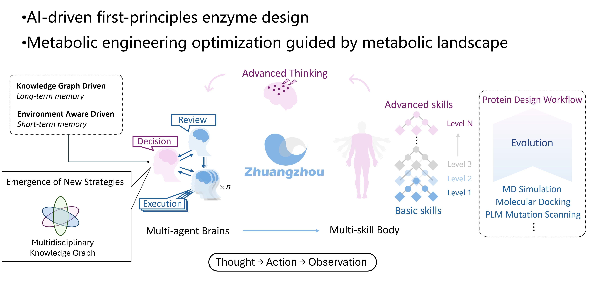
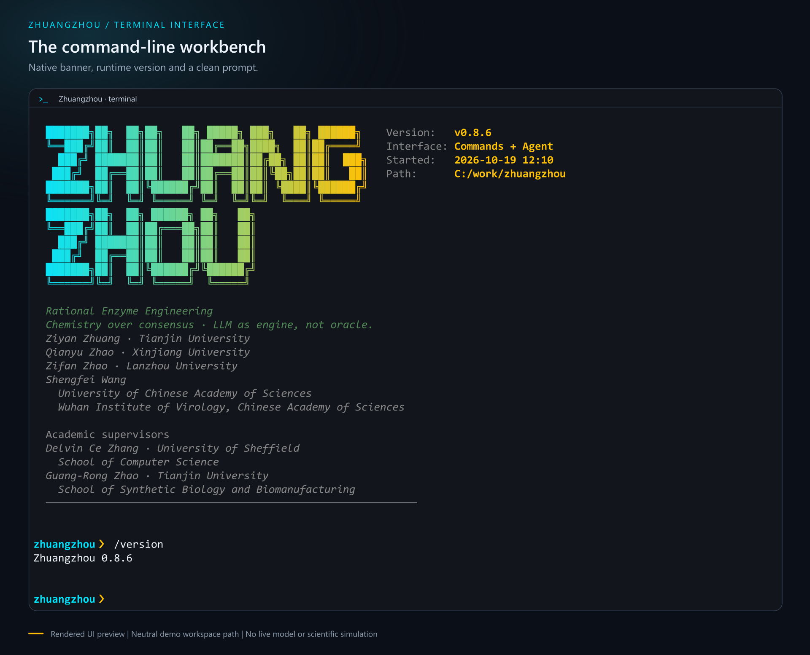

<h1 align="center">庄周 · Zhuangzhou</h1>

<p align="center">面向酶工程与代谢工程的科研 Agent 工作台。</p>

<p align="center">
  <a href="README.md">English</a> · <strong>简体中文</strong>
</p>

<p align="center">
  <a href="https://github.com/ZiyanZhuang/zhuangzhou/actions/workflows/tests.yml"></a>
  <a href="#快速开始"></a>
  <a href="pyproject.toml"></a>
</p>

<p align="center">
  <a href="#快速开始">快速开始</a> ·
  <a href="#使用方法">使用方法</a> ·
  <a href="#模块与运行条件">模块</a> ·
  <a href="#执行架构">架构</a> ·
  <a href="#验证">验证</a>
</p>

<p align="center">
  
</p>

<p align="center"><sub>保留项目原始架构插图。图中展示整体设计方向，各模块的实现与验证范围见下文。</sub></p>

庄周将终端 Agent、科学计算工具、工作流模板和执行记录连接起来，用于蛋白质
变体分析、分子建模、代谢网络分析和序列设计。可以直接调用 Python 模块，也可以
配置模型后，在终端中规划任务、调用工具并查看结果。

项目目前处于研究开发阶段。可运行的分析取决于已安装的软件和数据；执行成功
与科学结论成立是两层判断。

## 快速开始

需要 Python 3.10 或更高版本，建议使用独立环境。

```bash
git clone https://github.com/ZiyanZhuang/zhuangzhou.git
cd zhuangzhou
python -m venv .venv
```

根据所用终端激活环境：

| 终端 | 命令 |
| --- | --- |
| Windows CMD | `.venv\Scripts\activate` |
| Windows PowerShell | `.venv\Scripts\Activate.ps1` |
| Linux / macOS | `source .venv/bin/activate` |

安装核心包并启动：

```bash
python -m pip install -e .
zhuangzhou --version
zhuangzhou
```

启动界面、`/help`、`/version`、`/status` 和 `/quit` 不依赖模型后端。
`/status` 会显示实际导入的包路径，便于区分不同 Python 环境中的安装。

### 可选依赖

按实际任务安装所需功能组：

| 功能组 | 安装命令 | 用途 |
| --- | --- | --- |
| `nlp` | `python -m pip install -e ".[nlp]"` | 终端 Agent 的模型适配器 |
| `chem` | `python -m pip install -e ".[chem]"` | RDKit 与分子准备工具 |
| `codon` | `python -m pip install -e ".[codon]"` | DNAchisel 与密码子表工具 |
| `viz` | `python -m pip install -e ".[viz]"` | 绘图依赖 |
| `report` | `python -m pip install -e ".[report]"` | Word 报告生成 |
| `dev` | `python -m pip install -e ".[dev]"` | 测试、静态检查与打包工具 |

这些功能组只安装 Python 依赖。GROMACS、AmberTools、Vina、PyMOL、ChimeraX
等外部软件需要单独安装和配置。环境设置见
[安装与配置](../../wiki/Installation-and-Configuration-zh)，Python 依赖声明见
[pyproject.toml](pyproject.toml)。

## 使用方法

<p align="center">
  
</p>

<p align="center"><sub>由 v0.8.6 的终端 UI 渲染。工作路径为示例，Started 表示会话启动时间。图中未调用模型或运行科学模拟。</sub></p>

### 终端入口

| 命令 | 界面 |
| --- | --- |
| `zhuangzhou` 或 `zz` | 主终端，支持本地命令与 Agent 对话 |
| `zz-chat` | 独立的 Agent REPL |
| `zz-cli` | 参数式 CLI；通过 `zz-cli --help` 查看命令 |

主终端同时接受自然语言请求和命令：

| 命令 | 作用 |
| --- | --- |
| `/help` | 查看已注册命令 |
| `/status` | 查看包、Python 和依赖信息 |
| `/skills` | 查看已注册的科学计算技能 |
| `/model` | 选择已配置的模型后端 |
| `/confirm <skill>` | 使用已审查的参数执行一次待确认的高风险调用 |
| `/resume` | 恢复已保存的会话上下文 |
| `/quit` | 退出终端 |

Agent 命令需要配置后端。云端适配器分别读取 `ANTHROPIC_API_KEY`、
`DEEPSEEK_API_KEY` 或 `OPENAI_API_KEY`；Ollama 使用本地服务。凭据应保存在
环境变量或本地配置中。后端选择逻辑见 [nlp/backends.py](nlp/backends.py)。

高风险工具执行前会显示工具名、脱敏参数和确认命令。中断和失败会保留对应状态。
`/resume` 恢复会话上下文，不会重新启动外部模拟进程。

### Python 调用

独立模块无需模型即可使用。下面的示例查询项目自带的元件库：

```python
from zhuangzhou.synbio.parts import PartSelector

parts = PartSelector.select_promoter(
    organism="ecoli",
    strength=0.6,
    inducible=False,
    n_candidates=3,
)
for part in parts:
    print(part["name"], part["strength"])
```

其中的强度值是元件库中的相对注释，不是新构建体的实测表达量。更多示例见
[CLI 与使用指南](../../wiki/CLI-and-Usage-zh)。

## 模块与运行条件

| 方向 | 代码 | 范围与条件 |
| --- | --- | --- |
| Agent 与工具 | [nlp](nlp/)、[skills](skills/)、[agents](agents/) | 模型适配、路由、参数校验、专用 Agent 和有界工具执行。独立库调用不要求模型服务。 |
| 蛋白质与酶分析 | [mutation_enricher](mutation_enricher/)、[mutagenesis](mutagenesis/)、[enzyme_specificity](enzyme_specificity/) | 突变注释与结构上下文；部分分析需要结构文件、模型权重或外部工具。 |
| 分子对接与动力学 | [smartdocking](smartdocking/)、[gromacs_md](gromacs_md/)、[amber_md](amber_md/) | 输入准备、执行封装和结果分析。科学计算引擎与有效输入需另行提供。 |
| CYP、血红素与 QM | [cypforge_core](cypforge_core/)、[CYPamber](CYPamber/)、[nonstandard_res](nonstandard_res/)、[qm_engine](qm_engine/) | 血红素及配体准备、非标准残基和 QM 辅助工具。化学状态、参数和后端条件需逐项核验。 |
| 合成生物学 | [synbio](synbio/)、[codon_opt](codon_opt/) | 元件选择、序列约束与密码子优化。库内评分和设计启发式需要实验验证。 |
| 代谢模型与知识 | [metakg](metakg/)、[brain](brain/) | 代谢模型接口与知识检索；依赖模型文件、数据库和已配置的服务。 |
| 群体基因组学 | [genomics](genomics/) | VCF/PLINK 等工具的输入检查与命令规划。生成计划不代表分析已执行。 |
| 工作流与记录 | [workflow](workflow/)、[memory](memory/)、[report](report/) | JSON 工作流、执行历史、会话检查点和报告。部分报告功能需要 `report` 依赖组。 |

各领域示例见[能力说明](../../wiki/Capabilities)。代谢模型描述特定网络约束，
不等于完整的全细胞模拟器。对接评分、模型排序和语言模型解释也不能替代实验依据。

## 执行架构

运行时沿着请求、规划、工具执行、结果观察和下一步决策推进。已注册技能负责
校验输入；工作流负责解析步骤依赖和传播失败。部分领域工作流带有结果检查关卡，
覆盖范围取决于具体流程。

```text
请求 → Agent / 路由 → 已注册技能或工作流 → 结果检查
          ↑                                 ↓
          └────── 上下文、执行历史与检查点 ───┘
```

- [Agent 运行时](nlp/agent.py)：工具调用、确认和迭代上限。
- [工作流引擎](workflow/engine.py)：有序步骤、结果引用和失败状态。
- [执行历史](memory/execution_history.py)：执行结果与中断检查点。
- [复核关卡](nlp/supervisor.py)：确定性检查和模型辅助复核。

并发执行有容量上限。超时限制调用方的等待时间，不能强制终止任意运行中的
Python 代码。检查点保存上下文与进度，不能完整恢复每一个外部进程。
这些边界记录在[架构核验](docs/engineering/ARCHITECTURE_FINDINGS.md)中。

## 验证

[离线 CI](.github/workflows/tests.yml) 在 Ubuntu / Python 3.10 和
Windows / Python 3.12 上运行，覆盖单元与集成测试、故障注入、Wheel 安装检查、
关键静态检查和 CLI smoke test。

```bash
python -m pip install -e ".[nlp,report,dev]"
python -m pytest -q
```

实时 API 测试需要显式启用。离线模型响应是测试替身，不能据此判断在线模型性能
或科学模拟是否有效。需要人工操作的科学计算脚本不参与自动离线收集。

| 记录 | 内容 |
| --- | --- |
| [工程报告](docs/engineering/FINAL_REPORT.md) | 实际修复、已执行检查和剩余限制 |
| [终端 UI 核验](docs/engineering/UI_AUDIT.md) | CMD 行为、渲染检查、版本与状态信息含义 |
| [执行日志](docs/engineering/EXECUTION_LOG.md) | 问题复现、修改与验证证据 |

## 后续工作

当前优先项是提供带公开数据的小型可复现示例，补充各科学后端的超时与取消检查，
扩大集成验证范围，并接入实验结果以支持下一轮设计。酶与代谢网络的跨尺度优化
仍属于开发方向，目前不能作为已经验证的通用设计服务。

## 指导教师

| 姓名 | 单位 |
| --- | --- |
| Delvin Ce Zhang | 谢菲尔德大学 · 计算机学院 |
| Guang-Rong Zhao | 天津大学 · 合成生物与生物制造学院 |

## 项目链接

[项目展示页](https://ziyanzhuang.github.io/zhuangzhou/) · [Wiki](../../wiki) ·
[问题反馈](https://github.com/ZiyanZhuang/zhuangzhou/issues)

仓库排除大体积权重、本地服务配置、凭据和生成的模拟结果。包元数据声明采用
[MIT 许可证](pyproject.toml)。
